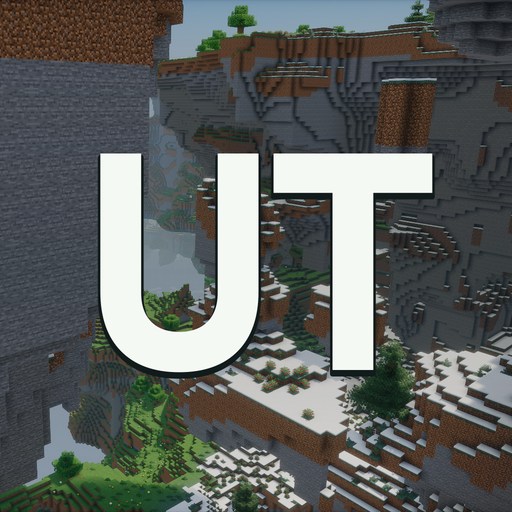

# Unstable Terrain

Unstable Terrain is an unofficial Minecraft Java Edition world-generation project inspired by the terrain in Unstable Universe. Explore a vast Great Sea, a snowy region called the Mist, an expanded Nether Underworld, and two routes into the Farlands. Version **1.0** targets Minecraft **1.21.11** and Java **21**.

## Explore the world

- **Farlands and Spokelands.** Follow 17 Farlands regions to the east and south, or nine Spokelands regions to the north and west. The terrain includes floating shelves, winding grass ribbons, bridges, colorful forests, sand formations, and SkyGrid.
- **Great Sea and Amplified.** Cross a deep ocean with beaches on both shores or explore the amplified terrain belt inland.
- **The Mist and Underworld.** Travel through a frozen region with persistent snowfall and reduced visibility, or descend below the vanilla Nether into the Underworld.
- **Landmark editions.** The standard build adds landmarks including the Lakerek Temple, Prince Zam Empire, and the Orbital array. The no-landmark build omits those landmarks and keeps vanilla structures, repeating dungeons, and bridge houses.

## Install version 1.0

| Platform | Setup |
| --- | --- |
| Fabric | Use Fabric Loader 0.18.4 or later and Fabric API 0.141.4 or later for Minecraft 1.21.11. Place one Fabric edition in `mods/`. Select the **Unstable** world type for a new single-player world, or set `level-type=greatsea:unstable` on a Fabric server before generating the world. |
| Paper | Place one Paper edition in `plugins/` before the first startup of a fresh Minecraft 1.21.11 server world. Paper runs as a standalone plugin. The matching client mod provides precise Mist fog for connected players. |

Install one edition per server or world. Terrain updates apply when new chunks generate. The local 1.0 release has separate standard and no-landmark JARs for each platform.

## Operator commands

`/farlands list`, `/spokelands list`, and `/greatsea list` show destinations. Use `/mist`, `/amplified`, and `/underworld` to reach those regions. `/unstableterrain settings` exposes mob spawning, Farlands fireworks, Farlands portals, and Underworld adventure mode. All Unstable Terrain commands require OP.

## Availability and credits

Unstable Terrain is a closed-source project. Keep this source repository private. Public project pages provide installation information, screenshots, and release downloads. The imported reference terrain, tree and structure assets and the generated Paper core are required for the complete 1.0 build and are supplied through the local project workspace. See [asset and publishing notes](ASSETS.md) and [Paper verification](docs/Paper-verification.md).

Project author: **BxltRust/Wlfies**. Inspiration: the Unstable Universe creators and builders. Tree models in the local build include work by **Horace Creations**. This is a fan project unaffiliated with Unstable Events or Mojang. The UT icon uses a screenshot from the project's Floating Farlands gallery.
