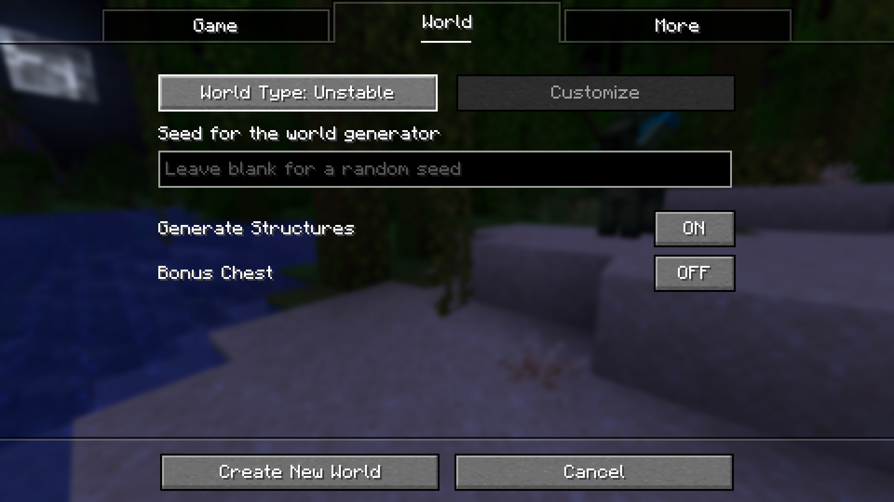

# Unstable Terrain

Unstable Terrain is an unofficial Minecraft Java Edition world-generation project inspired by the terrain in Unstable Universe. Explore a vast Great Sea, a snowy region called the Mist, an expanded Nether Underworld, and two routes into the Farlands. Version **1.0** targets Minecraft **1.21.11** and Java **21**.

[Orbital tutorial](#using-the-orbitals) · [Download version 1.0](https://github.com/Wlfiess/unstable-terrain/releases/tag/1.0)

## Explore the world

- **Farlands and Spokelands.** Follow 17 Farlands regions to the east and south, or nine Spokelands regions to the north and west. The terrain includes floating shelves, winding grass ribbons, bridges, colorful forests, sand formations, and SkyGrid.
- **Great Sea and Amplified.** Cross a deep ocean with beaches on both shores or explore the amplified terrain belt inland.
- **The Mist and Underworld.** Travel through a frozen region with persistent snowfall and reduced visibility, or descend below the vanilla Nether into the Underworld.
- **Landmark editions.** The standard build adds landmarks including the Lakerek Temple, Prince Zam Empire, and the Orbital array. The no-landmark build omits those landmarks and keeps vanilla structures, repeating dungeons, and bridge houses.

## Install version 1.0

| Platform | Setup |
| --- | --- |
| Fabric | Use Fabric Loader 0.18.4 or later and Fabric API 0.141.4 or later for Minecraft 1.21.11. Place one Fabric edition in `mods/`. Select the **Unstable** world type for a new single-player world, or set `level-type=greatsea:unstable` on a Fabric server before generating the world. |
| Paper | Place one Paper edition in `plugins/` before the first startup of a fresh Minecraft 1.21.11 server world. Paper runs as a standalone plugin. The matching client mod provides precise Mist fog for connected players. |

Install one edition per server or world. Terrain updates apply when new chunks generate. The local 1.0 release has separate standard and no-landmark JARs for each platform.

### Fabric world type

**For Fabric single-player, you must select the Unstable world type when creating your world.** Open **Singleplayer → Create New World → World**, then click **World Type** until it reads **Unstable**, as shown below. Then create the world.

For a Fabric server, set `level-type=greatsea:unstable` in `server.properties` before generating the world.

## Using the Orbitals

Use the standard edition with custom landmarks enabled in an Unstable world. The array has 100 stations with alternating Stab Shots and Nuke Shots.

1. **Reach the control platform.** Operators can use `/farlands orbitals` to reach it. Find the existing lever by the **on/off** sign on the main platform.
2. **Arm the array.** Put the signed control into its on position and stay nearby for **30 seconds**. The sky advances rapidly while the control is active. Wait for the armed message, then keep the lever on while loading rods.
3. **Link a rod.** Cast a normal fishing rod onto a station's **oak pressure plate**. Wait for the message confirming that a Stab Shot or Nuke Shot is linked. Each station has a preset shot type.
4. **Have your pearl stasis pulled.** Set up the receiving stasis beforehand. With the rod still linked and in your inventory, have a partner pull you **at least 50 blocks** from both your starting position and the station, within the Overworld. Keep the rod cast until the pull.
5. **Let the station leave simulation.** Other players and chunk loaders must also be far enough away for that station to stop ticking. Low simulation distance helps. Fifty blocks is the minimum travel requirement, and higher simulation distances require a longer pull. Once pulled, the system waits up to **30 seconds** for the station to leave simulation.
6. **Check the rod name.** A successful load renames it **Stab Shot** or **Nuke Shot**. Aim at a loaded target within **128 blocks** and use the rod to fire. The charged rod is consumed and plays the item-break sound.

| Shot | Effect |
| --- | --- |
| Stab Shot | Starts after about **0.3 seconds** at normal tick speed and blasts a narrow, irregular shaft through the target column, including blocks above and below you. Uses TNT explosions and respects blast resistance. |
| Nuke Shot | Starts as one TNT charge above the target, then expands into multiple uneven rings that share a detonation time. Aim directly at a solid block. |

**Loading limits.** The armed loading window lasts **10 minutes**. If it expires, switch the control off and back on, then wait another 30 seconds. Each station supplies one rod per arming cycle. Completing another arming cycle replenishes undamaged stations. Breaking a block belonging to a station marks that station as damaged and prevents further loading from it. Charged rods already issued remain usable after the loading window expires.

**If a rod will not load.** Check the lever, armed message, pressure plate, station stock, and station damage. After a valid pull, the station must leave entity simulation. Standing at the plate alone does not complete loading. Nether portals are disabled in the Orbital region.

**Single-player test for operators.** Link a rod to an armed station, then run `/unstableterrain orbitalpull`. It simulates the pull and chooses a safe landing far enough away for your simulation distance. All Unstable Terrain commands require OP.

The accelerated sky and Breeze firing run while the control platform is active and ticking. The sky returns to its normal cycle when that platform unloads or the control is switched off.

## Operator commands

`/farlands list`, `/spokelands list`, and `/greatsea list` show destinations. Use `/mist`, `/amplified`, and `/underworld` to reach those regions. `/unstableterrain settings` exposes mob spawning, Farlands fireworks, Farlands portals, and Underworld adventure mode. All Unstable Terrain commands require OP.

## Support and future versions

Support for more Minecraft versions and additional mod loaders is coming.

If you have problems or find bugs, contact **wlfiess** on Discord. Include your Minecraft version, platform (Fabric or Paper), mod version, and the steps to reproduce the issue. Attach screenshots or a crash report when relevant.

## Availability and credits

Unstable Terrain is a closed-source project. Keep this source repository private. Public project pages provide installation information, screenshots, and release downloads. The imported reference terrain, tree and structure assets and the generated Paper core are required for the complete 1.0 build and are supplied through the local project workspace. See [asset and publishing notes](ASSETS.md) and [Paper verification](docs/Paper-verification.md).

Project author: **BxltRust/Wlfies**. Inspiration: the Unstable Universe creators and builders. Tree models in the local build include work by **Horace Creations**. This is a fan project unaffiliated with Unstable Events or Mojang. The UT icon uses a screenshot from the project's Floating Farlands gallery.
